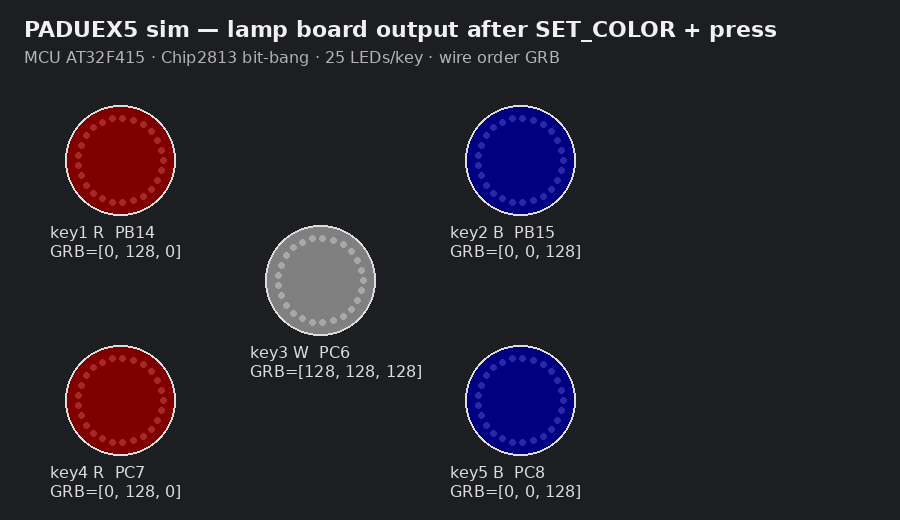

# PADUEX5 离线仿真自测报告

**结果：53/53 通过，0 失败**

## 能证明 / 不能证明

| 能证明 | 不能证明 |
|--------|----------|
| paduex5_1.3 与原厂同体积、向量合法、仅改 SendPacket | 客户板真实 OTA/ISP 刷写 |
| 改色协议 CRC/ACK、灯板 GRB×25 逻辑输出与 UI 一致 | WS2812 真实电时序 |
| 模式位 KBS/HID×1P/2P 编解码与复位写 Flash | USB 重新枚举 PID |
| 改键 GET/SET_MAPP 往返与 0x08011800 持久化模型 | 真机 HID usage 注入游戏 |

## 灯色仿真预览

## 明细

- ✅ **paduex5_1.3 size == stock** — `37072`
- ✅ **paduex5_1.3 size == paduex5_1.2**
- ✅ **vector SP in SRAM** — `0x20002a20`
- ✅ **vector Reset in APP** — `0x8004261`
- ✅ **does not reach config page** — `0x800d0d0`
- ✅ **1.3 only patches KBS/HID SendPacket** — `6 regions in SendPacket only`
- ✅ **KBS has timeout counter lsl #19** — `push {r4, r5, r6, r7, lr} | mov r4, r0 | mov r5, r1 | ldr r6, [pc, #0x30] | ldr r0, [r6, #4] | ldr r7, [r0, #0x24] | mov`
- ✅ **KBS still BL send_report path**
- ✅ **HID has timeout counter lsl #19** — `push {r4, r5, r6, r7, lr} | mov r4, r0 | mov r5, r1 | ldr r6, [pc, #0x34] | ldr r0, [r6, #4] | ldr r7, [r0, #0x24] | mov`
- ✅ **HID still BL send_report path**
- ✅ **Mapping_Load BL unchanged vs 1.2** — `fff780fc`
- ✅ **COLOR page addr 0x08010800 still in image**
- ✅ **MAPP page addr 0x08011800 still in image**
- ✅ **build_paduex5_1.3.py reproducible**
- ✅ **SET_COLOR CRC valid** — `cs=51`
- ✅ **SET_COLOR device ACK** — `574f4b5101`
- ✅ **COLOR saved to flash page model**
- ✅ **GET_COLOR round-trip** — `got=['R', 'B', 'W', 'R', 'B']`
- ✅ **LED key1 wire GRB×25 == R** — `pixel0=GRB(0, 128, 0) expect(0, 128, 0) gpio=PB14`
- ✅ **LED key2 wire GRB×25 == B** — `pixel0=GRB(0, 0, 128) expect(0, 0, 128) gpio=PB15`
- ✅ **LED key3 wire GRB×25 == W** — `pixel0=GRB(128, 128, 128) expect(128, 128, 128) gpio=PC6`
- ✅ **LED key4 wire GRB×25 == R** — `pixel0=GRB(0, 128, 0) expect(0, 128, 0) gpio=PC7`
- ✅ **LED key5 wire GRB×25 == B** — `pixel0=GRB(0, 0, 128) expect(0, 0, 128) gpio=PC8`
- ✅ **LED all off on release**
- ✅ **Host UI palette ⊆ {R,B,W}**
- ✅ **SET_COLOR bad CRC rejected**
- ✅ **SET_MODE encode KBS+1P** — `0x00`
- ✅ **SET_MODE applies KBS+1P**
- ✅ **GET_MODE KBS+1P** — `4700a2010213`
- ✅ **KBS+1P → KBS PID family 0x576x** — `VID 0x4D47 PID 0x5761/62`
- ✅ **SET_MODE encode KBS+2P** — `0x80`
- ✅ **SET_MODE applies KBS+2P**
- ✅ **GET_MODE KBS+2P** — `4780a2010213`
- ✅ **KBS+2P → KBS PID family 0x576x** — `VID 0x4D47 PID 0x5761/62`
- ✅ **SET_MODE encode HID+1P** — `0x01`
- ✅ **SET_MODE applies HID+1P**
- ✅ **GET_MODE HID+1P** — `4701a2010213`
- ✅ **HID+1P → HID PID family 0x577x** — `VID 0x4D47 PID 0x5771/72`
- ✅ **SET_MODE encode HID+2P** — `0x81`
- ✅ **SET_MODE applies HID+2P**
- ✅ **GET_MODE HID+2P** — `4781a2010213`
- ✅ **HID+2P → HID PID family 0x577x** — `VID 0x4D47 PID 0x5771/72`
- ✅ **WMODE flash page written**
- ✅ **stock FW: GET_MAPP fails (no protocol)**
- ✅ **paduex5: GET_MAPP header**
- ✅ **default map 5Key = W X A D S** — `[26, 27, 4, 7, 22]`
- ✅ **SET_MAPP CRC**
- ✅ **SET_MAPP ACK** — `4f4f4b81`
- ✅ **MAPP flash @0x08011800**
- ✅ **GET_MAPP after save** — `[11, 13, 14, 15, 16]`
- ✅ **Mapping table length 12**
- ✅ **binary contains MAPP flash addr**
- ✅ **default usages (u16 LE) present in image** — `1a001b00040007001600140008001d0006005500`

## 发给客户前建议

1. 用本仓库 **OTA** 在自有一块板上刷 `paduex5_1.3.bin`，确认仍能被 PADUEX5 识别。
2. 再测：改色（红/白/蓝）、键盘↔手柄模式、改键保存后拔插。
3. 勿用 ISP 刷 paduex5_1.1；ISP 请用 paduex5_1.3（37072 字节 @ `0x08004000`）。
